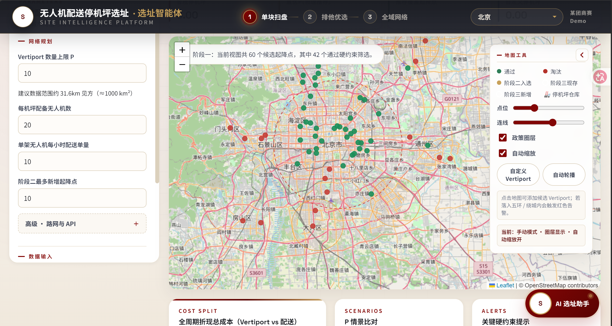
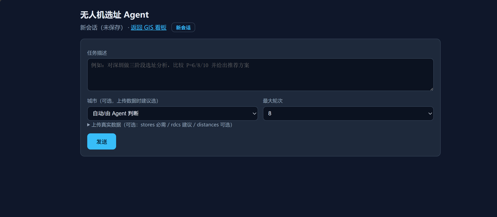

# 无人机低空物流选址 Agent

> 面向城市无人机配送网络的三阶段选址引擎 + 可自主调用工具的对话式 Agent。
> 从候选起降点筛选、空域冲突衰减，到机坪（vertiport）投放与最近邻配送分配，提供一套可运行、可视化、可复现、可追问的决策工具。




## 项目简介

本项目解决的问题：在低空物流场景中，如何为一个城市决定 **哪些起降点（pad）值得服务、在哪些机坪（vertiport）投放无人机、每个机坪覆盖哪些起降点**，以在运力约束下最大化配送需求覆盖。

系统由两部分组成：

1. **三阶段选址引擎**（纯 Python，无商业求解器）
2. **选址 Agent**：基于 function calling 的多轮工具调用循环，支持知识库检索（RAG）、自定义数据上传、多轮会话记忆，并通过 MCP 协议把同一批工具暴露给外部客户端

> 演进说明：本项目前身为某团商赛的「社区超市门店 + RDC 选址」系统，后将业务语义整体重写为无人机低空物流场景（门店 → 起降点，RDC → 机坪，财务 ROI 目标 → 物理网络覆盖目标），并在其上构建了 Agent 层。

## Agent 四层架构

```text
┌─ 协议层   mcp_server.py        同一批工具以 MCP(stdio JSON-RPC) 暴露，长任务进度心跳
├─ 编排层   agent_orchestrator.py 多轮工具循环、只读并行、checkpoint 续跑、trace、上下文裁剪
├─ 上下文层 分层 system 提示（领域常识+工具规范+工作流）+ RAG 召回 + 会话历史
└─ 工具层   agent_tools.py        run_site_selection / load_csv / get_city_configs
                                  / regeo_label(高德逆地理) / rag_retrieve
```

核心设计决策：**MCP 与内部编排器共用同一份工具实现**（`agent_tools._TOOL_IMPLS`），协议层只是适配，不复制业务逻辑。



## 主要能力

**三阶段选址引擎**

- Stage 1：按需求权重累计前 70% 门槛初筛起降点 + 场地/坐标落地校验
- Stage 2：空域/噪声冲突衰减模型（280m / 320–500m 分段衰减），最大化衰减后覆盖量，硬门槛 ≥ 20
- Stage 3：机坪硬约束（禁飞区剔除、净空 < 3m 剔除、内环限飞区剔除、每机坪 ≤ 11 起降点、覆盖半径 5km），枚举 P=1..15 并按「覆盖点数降序、平均距离升序」标记推荐方案

**选址 Agent**

- 多轮工具调用循环：LLM 自主决定调用选址引擎、逆地理编码、知识库检索
- 只读工具线程池并行执行；每步落盘 checkpoint，可中断续跑
- 完整 trace（工具名/参数/结果摘要/token/耗时），自动生成 Markdown 分析报告
- 会话持久化到文件，支持多轮记忆与页面刷新恢复

**轻量 RAG（零向量库依赖）**

- 纯 Python + numpy：段落切块 + 中文二元组/英文词 TF-IDF 余弦检索 + 口语查询扩展 + 领域锚点词门控
- 7 篇领域文档 / 129 个片段，内容全部与代码常量核对一致
- 检索结果带 `文件名#段N` 出处，回答可溯源
- 领域内外判定：扩展后的查询必须命中至少一个领域锚点词（机坪/起降点/衰减/禁飞区/净空/数据契约/成本参数等），否则视为领域外直接返回空；相比「未登录词占比」门槛，不会误杀「表格里没写城市那一列」这类口语化但确属本领域的问题

离线评测 `eval_rag.py` 用四组测试集，刻意区分「按文档术语出的题」和「模拟真实用户的口语题」：

| 测试集 | 规模 | 关键词覆盖率 | 完全命中率 | Top1 命中 |
|---|---|---|---|---|
| 标准集（术语问法） | 52 正例 | 100% | 100% | 75.0% |
| 口语盲测集（调参用） | 28 正例 | 100% | 100% | 96.4% |
| 回归集（原留出集，已污染降级） | 14 正例 | 100% | 100% | 78.6% |
| **留出集（独立构造，只跑一次）** | **14 正例** | **100%** | **100%** | **92.9%** |

负例方面：12 条领域外问题 + 3 条「无人机相关但知识库未覆盖」的硬核负例，误召回均为 0（后者通过显式领域边界声明实现）。

**怎么看这组数字（诚实版）**：标准集满分是自评偏差——题目用词贴近文档，TF-IDF 词面匹配必然命中。此前那组 14 条留出集在机制修正时被逐条错误分析使用过，信息已泄露，因此降级为回归集；表中「留出集」是在锚点词门控与同义映射扩充完成之后**重新独立构造**、用 `--holdout` 只跑一次的验收结果。仍需说明两点局限：新留出集的题目仍带有部分文档词汇（作者与出题人相同，残留偏差无法完全消除），且 14 条样本量很小，14/14 的 95% 置信区间下限约 77%，不能当作通用准确率。真正的提升来自机制修正：锚点词门控消除了口语问题的误拒，同义映射补齐了「放进来 / 离得太近 / 一个点没覆盖 / 数量开到」等转述说法。


**MCP Server**

- 零框架 stdio JSON-RPC 2.0：`initialize` / `tools/list` / `tools/call`
- 长任务保活：客户端携带 `progressToken` 时，选址执行期间按间隔发送 `notifications/progress`（实测 38.5s 任务发出 9 条进度）

**数据与地图**

- 支持上传 CSV/Excel 真实数据（`load_csv`），最小契约：起降点 `pad_id/lat/lon`（需求量放 `rf_sales_10k`），机坪 `vertiport_id/lat/lon/altitude_limit_m`
- 高德逆地理编码：把推荐机坪/起降点坐标转成「区·街道·商圈」可读标签，进程内缓存
- Leaflet GIS 看板：三阶段时间轴、空域限制区、机坪-起降点连线

## 快速启动

```bash
git clone https://github.com/philyang2003-byte/community_supermarket_site_selection.git
cd community_supermarket_site_selection

python -m venv .venv
.venv\Scripts\activate          # Windows；Linux/Mac: source .venv/bin/activate
pip install -r requirements.txt # 如需上传 Excel，另装 pandas

cp .env.example .env            # 填入模型密钥与高德 Key
python app.py
```

打开：

- GIS 看板：<http://127.0.0.1:5001/>
- Agent 对话：<http://127.0.0.1:5001/agent>

点击「运行样例」或在 Agent 页直接提问「对深圳做一次选址，P 取 1,3,6,10 对比」即可复现完整链路。

### 环境变量（.env）

| 变量 | 用途 |
| --- | --- |
| `DEEPSEEK_TOKEN` | 模型 API 密钥（任何 OpenAI 兼容端点） |
| `DEEPSEEK_BASE` | 端点地址，默认 `https://api.deepseek.com/v1`；境外端点（如 OpenRouter）需系统代理，代码已自动遵循 |
| `DEEPSEEK_MODEL` | 模型名，默认 `deepseek-chat` |
| `AMAP_KEY` | 高德 Web 服务 Key（逆地理编码，可选，缺省退回裸坐标） |

密钥只从 `.env` / 环境变量读取，不入库、不打印（`.env` 已在 `.gitignore`）。

### CLI 与评测

```bash
python run_agent.py --task "对深圳做选址，P 取 1,3,6,10 对比" --city shenzhen   # 命令行跑 Agent
python eval_rag.py                                                              # 复现标准集/盲测集/回归集指标
python eval_rag.py --holdout                                                    # 运行独立留出集（仅最终验收跑一次）
echo '{"jsonrpc":"2.0","id":1,"method":"tools/list"}' | python mcp_server.py    # 验证 MCP
```

## 样例实测结果（深圳，合成数据）

漏斗：347 候选起降点 → Stage1 通过 116 → Stage2 选中 2 → 合格机坪 235 个。

| P | 覆盖起降点 | 覆盖需求权重 | 平均距离 km | 推荐 |
| --- | --- | --- | --- | --- |
| 1 | 2 | 4,104.0 | 0.000 | |
| 3 | 8 | 4,104.0 | 0.000 | |
| 6 | 14 | 10,881.0 | 0.000 | |
| **10** | **21** | **13,401.0** | **0.273** | ★ |

**口径说明（重要）**：`rf_sales_10k` 是样例合成的需求权重，不是真实日单量；平均距离含机坪与起降点同址的 0 距离边，会拉低均值；P=1/P=3 覆盖量相同是因为样例中 5 个存量起降点需求为 0 且与机坪同址。北京/杭州样例仅 3 个机坪，Stage3 无结果——深圳样例数据最完整，演示请用深圳。

## API 摘要

| Endpoint | Method | 用途 |
| --- | --- | --- |
| `/` | GET | GIS 看板主界面 |
| `/agent` | GET | Agent 对话界面 |
| `/api/run` / `/api/run-sample` | POST | 上传数据 / 内置样例运行选址模型 |
| `/api/cities` | GET | 城市 GIS 元数据（仅支持北京/杭州/深圳） |
| `/api/agent/chat` | POST | Agent 对话（支持 session_id 多轮记忆、上传文件） |
| `/api/agent/upload` | POST | 上传 CSV/Excel 到临时目录 |
| `/api/agent/session/<id>` | GET | 拉取会话历史（页面刷新恢复） |
| `/api/agent-outputs` | GET | 列出/下载 Agent 生成的报告 |
| `/api/chat/stream` | POST | 旧版流式聊天（OpenClaw fallback 通道） |

## 项目结构

```text
.
├── app.py                    # Flask API、样例装载、高德逆地理、Agent HTTP 端点
├── optimizer.py              # 三阶段选址引擎核心
├── agent_llm.py              # OpenAI 兼容 function-calling 客户端（遵循系统代理）
├── agent_tools.py            # 工具注册表：选址/装载/检索/逆地理 + schema + 并行分发
├── agent_orchestrator.py     # Agent 主循环：并行只读、checkpoint、trace、上下文裁剪
├── session_store.py          # 会话文件持久化（agent_outputs/sessions/）
├── rag_retriever.py          # 轻量 TF-IDF 检索器
├── mcp_server.py             # 极简 MCP server（stdio JSON-RPC + 进度心跳）
├── run_agent.py              # CLI 入口
├── eval_rag.py               # RAG 离线评测（标准集 + 口语盲测 + 回归集 + 独立留出集）
├── knowledge/                # 领域知识库（7 篇，129 片段）
├── templates/                # index.html(GIS 看板) / agent.html(Agent 对话)
├── sample_data/              # 三城样例数据
└── docs/
    ├── MODEL.md              # 模型、公式与约束
    ├── DATA_UPLOAD.md        # 自定义数据契约与常见坑
    └── DEMO.md               # 面试演示脚本
```

## 已知边界（诚实声明）

- 覆盖单量为样例合成权重，**非真实业务数据**；财务成本字段沿用原超市数据占位，真实商用需重录造价与换电成本
- 用户上传的数据集注册表保存在进程内存，**服务重启后需重新上传**
- MCP 进度心跳只能缓解客户端空闲超时，硬超时极短的客户端仍可能断开（根治需两段式任务接口）
- 境外模型端点依赖系统代理；国内端点（DeepSeek 官方）可直连
- 无 pytest 单测，正确性验证依赖 `eval_rag.py` 与接口级冒烟测试

## License

MIT License. See [LICENSE](LICENSE).
