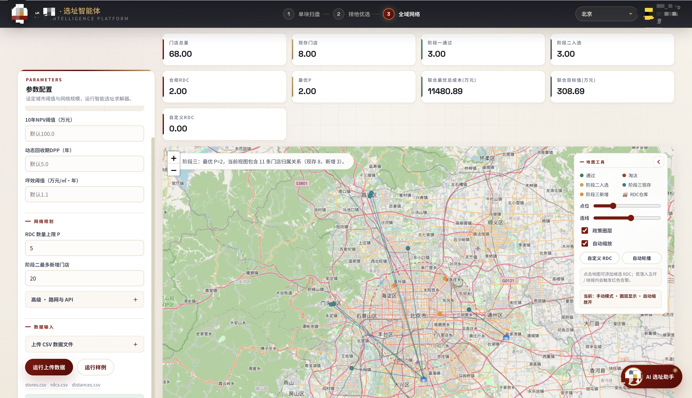
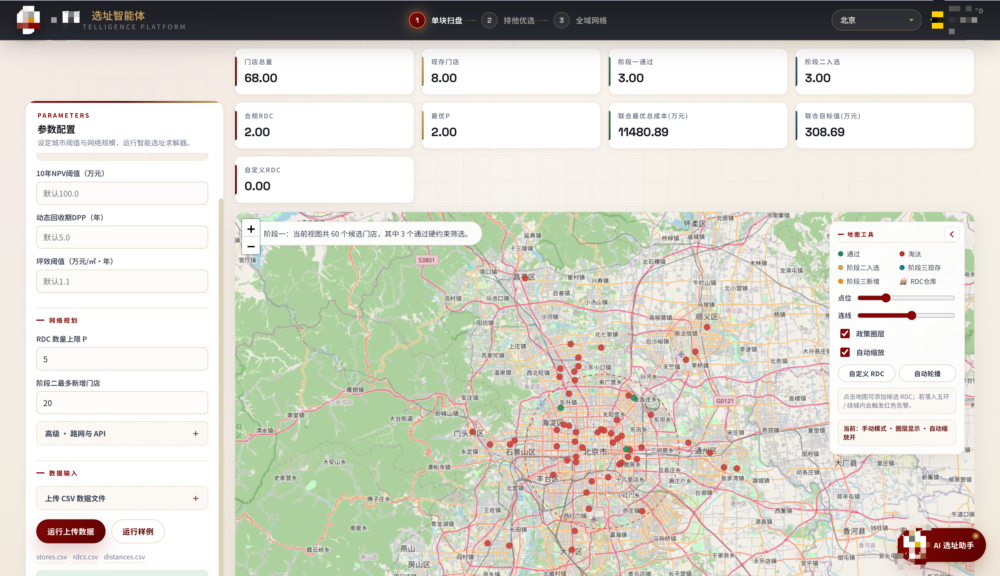
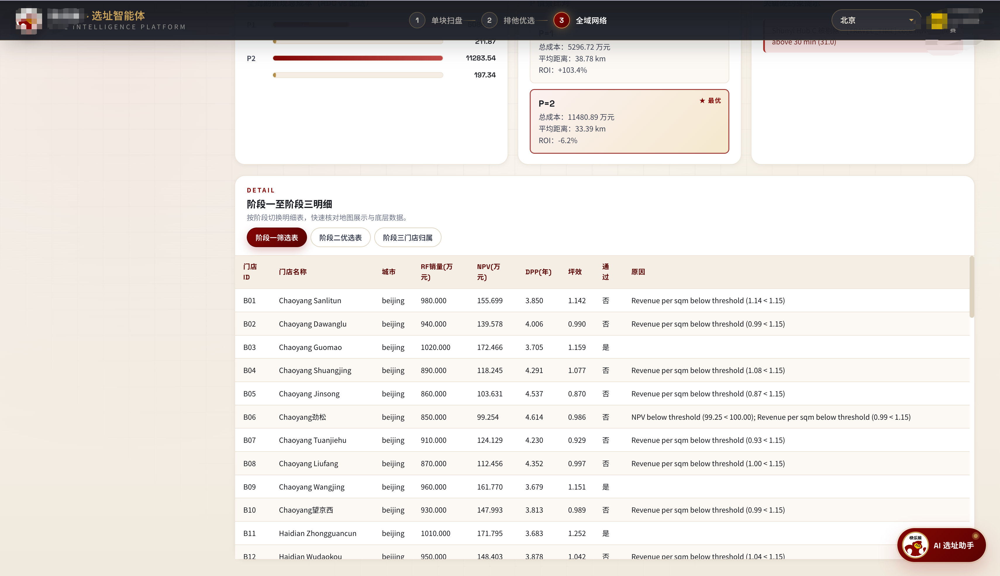
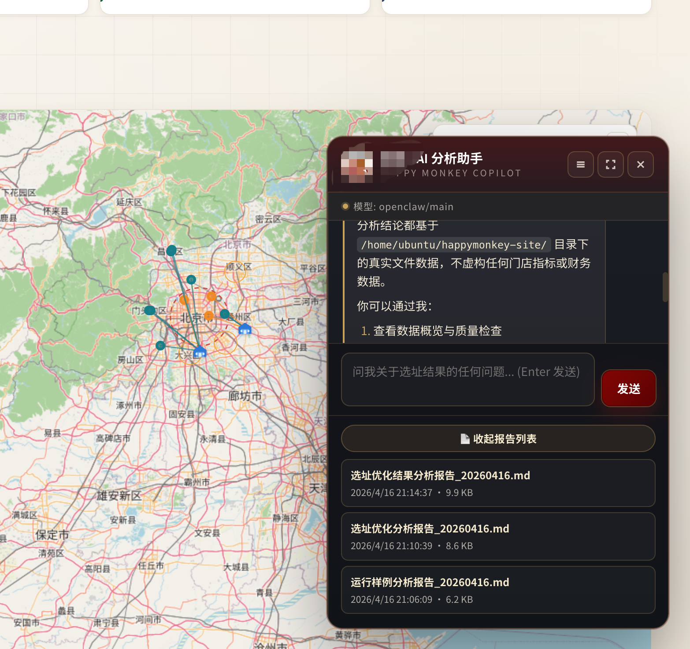

# Community Supermarket Site Selection

> 面向社区超市扩张的门店选址与 RDC 配送网络联合优化系统。  
> 从候选门店财务筛选、相邻新店蚕食控制，到区域配送中心选址与 AI 解释分析，提供一套可运行、可视化、可复现的决策工具。




## 项目简介

本项目来自某团商赛场景：一家社区超市品牌计划在北京、杭州等城市扩张，需要同时回答三个问题：哪些候选门店值得开、相邻新店是否会互相分流、需要开几个 RDC 才能支撑全网配送。

我将这个业务问题拆成一个三阶段联合优化系统：先用 NPV、DPP、坪效做单店财务筛选，再用距离衰减模型处理新店蚕食，最后用 P-median 思路枚举 RDC 组合并分配门店。系统提供 Flask 后端、Leaflet GIS 前端和 OpenClaw AI 对话助手，可以上传 CSV 或直接运行样例数据，在地图上查看三阶段结果。

## 界面速览

### Stage 1：单点财务筛选

在 GIS 地图上查看候选门店通过/淘汰结果，结合 NPV、DPP、坪效阈值快速定位财务可行点位。



### Stage 2：相邻新店蚕食控制

对入选新店绘制 300m/500m 圈层，直观看到相邻门店的排他关系和客流分流风险。


### Stage 3：RDC 配送网络方案

展示 RDC 与门店分配连线，对比不同 P 情景下的 RDC 成本、配送成本、平均距离和 ROI。


### 结果明细与 AI 分析助手

明细表用于核对每个阶段的底层数据；AI 助手通过 SSE 流式返回，对选址结果、硬约束和成本结构做解释。

| 明细表 | AI 助手 |
| --- | --- |
|  |  |

## 技术亮点

**三阶段联合优化模型**  
不是简单套用现成机器学习模型，而是围绕业务约束设计了“财务筛选 + 蚕食衰减 + RDC 网络优化”的完整求解链路。Stage 2 与 Stage 3 使用联合目标 `新增门店修正 NPV - 全网络配送成本 PV`，减少分段决策带来的偏差。

**纯 Python 求解器，无商业优化器依赖**  
核心求解逻辑使用组合枚举、剪枝和 beam search 实现，不依赖 Gurobi/CPLEX。候选组合较小时精确枚举，组合爆炸时自动切换 beam search，保证演示数据可直接运行。

**SSE 流式 AI 对话链路**  
OpenClaw 侧通过 WebSocket 推送 agent 事件，后端用线程 + `queue.Queue` 转成 Flask SSE 流，再由前端增量渲染。这个设计把“长时间等待整段回复”的体验改为“尽快看到首字输出”，适合复杂分析任务。

**WebSocket → Queue → SSE 跨线程桥接**  
`openclaw_client.py` 在独立线程中维护 WebSocket 生命周期，主线程通过 generator 持续 yield `session/delta/done/error` 事件，避免阻塞 Flask 响应。

**Leaflet 三阶段地图时间轴**  
前端用 Vanilla JS + Leaflet.js 实现阶段切换、政策禁区、物流带、自定义 RDC 点位校验、RDC-门店连线和成本看板，没有引入重型前端框架。

## 技术栈

| 层 | 技术 |
| --- | --- |
| Backend | Python 3.12, Flask |
| Optimization | Pure Python, combinations, pruning, beam search, haversine distance |
| Frontend | HTML, CSS, Vanilla JavaScript |
| GIS | Leaflet.js, OpenStreetMap tiles |
| AI Integration | OpenClaw WebSocket, DeepSeek-backed agent, SSE streaming |
| Deployment | Tencent Cloud CVM, environment variables, shell deployment script |

## 快速启动

```bash
git clone https://github.com/philyang2003-byte/community_supermarket_site_selection.git
cd community_supermarket_site_selection

python3 -m venv .venv
source .venv/bin/activate
python3 -m pip install -r requirements.txt

python3 app.py
```

打开：

```text
http://127.0.0.1:5001
```

点击 **运行样例** 即可使用 `sample_data/` 中的内置数据跑完整模型。

### 可选：启用 AI 对话

AI 聊天不是运行优化模型的必要条件。如果需要启用，请设置环境变量：

```bash
export OPENCLAW_TOKEN="<your_openclaw_token>"
export OPENCLAW_WS_URL="ws://127.0.0.1:18789"
export OPENCLAW_AGENT_ID="main"
python3 app.py
```

也可以复制示例配置：

```bash
cp .env.example .env
cp start.sh.example start.sh
```

注意：项目没有强制依赖 `python-dotenv`，`.env` 主要作为配置模板；生产环境建议由 shell、systemd、容器平台或 CI/CD 注入环境变量。

## 项目结构

```text
.
├── app.py                    # Flask API、CSV/Excel 解析、AMap 距离、SSE chat endpoints
├── optimizer.py              # 三阶段选址与 RDC 网络联合优化核心
├── openclaw_client.py        # OpenClaw WebSocket 客户端与 SSE 事件桥接
├── templates/index.html      # 主页面模板
├── static/
│   ├── app.js                # 地图、表格、聊天、状态管理
│   └── style.css             # 展示系统样式
├── sample_data/              # 可直接运行的样例门店、RDC、距离矩阵
├── docs/
│   ├── MODEL.md              # 优化模型、公式和约束说明
│   └── assets/               # README 展示截图
├── .env.example              # 环境变量模板
├── start.sh.example          # 启动脚本模板
└── LICENSE                   # MIT License
```

## 模型概览

1. **Stage 1：单店财务筛选**  
   对每个新门店候选点计算 10 年 NPV、折现回收期 DPP 和坪效，过滤不满足城市阈值的点位。既有门店直接进入 Stage 3 网络规划。

2. **Stage 2：新店蚕食优化**  
   计算同城候选点间距离。距离过近时禁止同时开店，300m-500m 附近区域使用线性衰减降低销售与 NPV。

3. **Stage 3：RDC + 门店联合优化**  
   先用蓝牌通行、净高、三温仓、消防、租期、租金上限、禁区等硬约束筛选 RDC，再枚举不同 P 值下的 RDC 组合并分配门店，输出全网折现成本、配送距离和 ROI。

更完整的公式、约束和搜索策略见 [docs/MODEL.md](docs/MODEL.md)。

## API 摘要

| Endpoint | Method | 用途 |
| --- | --- | --- |
| `/` | GET | 返回主界面 |
| `/api/cities` | GET | 城市 GIS 元数据与默认阈值 |
| `/api/run` | POST | 上传门店/RDC/距离 CSV，运行完整模型 |
| `/api/run-sample` | POST | 使用内置样例数据运行模型 |
| `/api/validate-rdc-point` | POST | 校验自定义 RDC 是否落入禁区 |
| `/api/chat/stream` | POST | AI 对话 SSE 流式端点 |

## 输入数据

最小可运行输入包括：

- `stores.csv`：门店候选点，包含 `store_id`, `city`, `lat`, `lon`, `rf_sales_10k`, `area_sqm`, `initial_investment_10k`, `annual_fixed_cost_10k`, `is_existing` 等字段。
- `rdcs.csv`：RDC 候选点，包含坐标、面积、投资、租金、运营成本和硬约束字段。
- `distances.csv`：可选距离矩阵。若缺失，模型使用经纬度 haversine 距离兜底。

仓库内置样例位于 [sample_data](sample_data)。

## License

MIT License. See [LICENSE](LICENSE).
